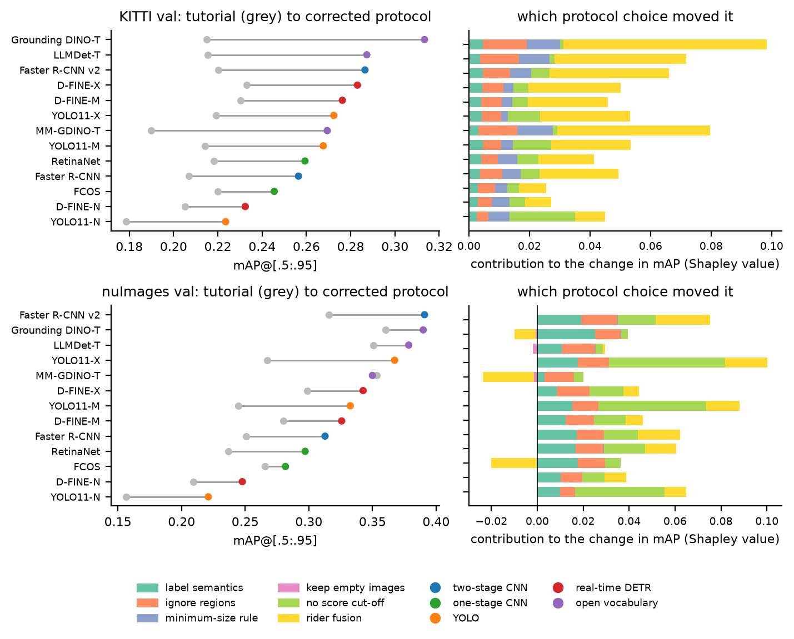
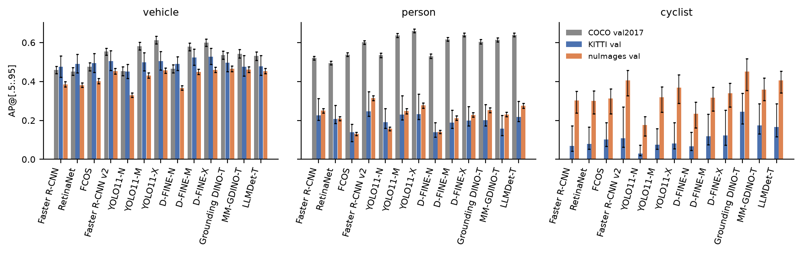
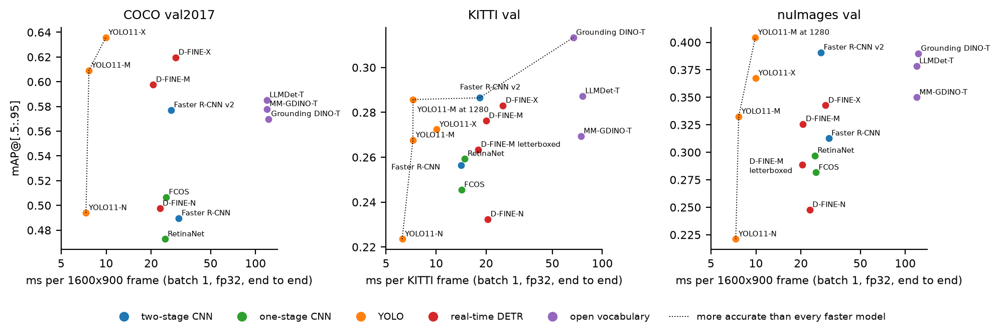
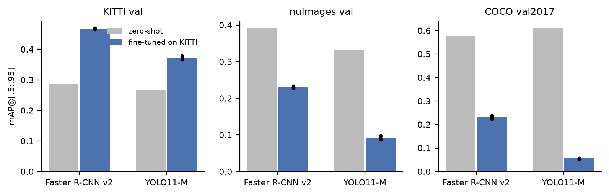
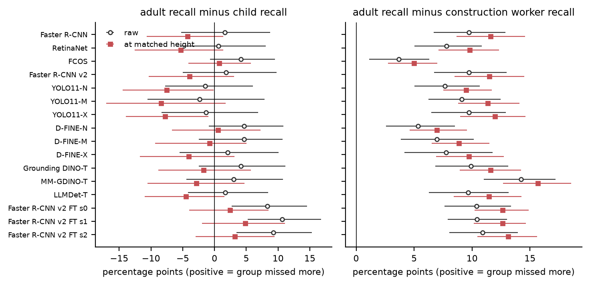

# COCO to driving: how far do 2D detectors transfer, and how much does the protocol decide?

Thirteen pretrained detectors from five families (two-stage CNN, one-stage CNN, YOLO, real-time
DETR, open vocabulary; ten trained on COCO, three open-vocabulary models trained on Objects365 and
grounding data, LLMDet's further training also using COCO images) evaluated without retraining on COCO val2017, KITTI val and the full nuImages validation set,
plus fine-tuning on KITTI, a latency benchmark and a pedestrian subgroup analysis. Every main-table mAP
comes with a 95% confidence interval from a bootstrap that resamples whole drives (KITTI), logs
(nuImages) or images (COCO), and every difference called significant is a paired test on the same
images.

The work starts from the zero-shot harness in the
[DeepDataMiningLearning ngdet tutorial](https://github.com/lkk688/DeepDataMiningLearning/tree/main/DeepDataMiningLearning/ngdet),
reproduces its published table (differences of at most 0.0008 for the closed-set entries
and 0.0041 for Grounding DINO), and then measures how the evaluation choices it already lists
as caveats (fixed score threshold, cyclist mapping, sample size), together with four further protocol
choices, change the answer.

## Findings

1. **The tutorial's numbers reproduce.** Its own code at a pinned commit gives the published values on
   COCO, nuImages and KITTI with differences of at most 0.0008 for the closed-set models and 0.0041 for Grounding DINO
   (Faster R-CNN v2: 0.581, 0.299, 0.279). The KITTI column comes from
   the first 120 images of the KITTI *train* list. This repo's harness, run in tutorial mode on the same
   images, matches ngdet to four decimals on all eight closed-set cases.
2. **On the driving sets the largest protocol effect on one model is 0.10 mAP (YOLO11-X on nuImages),
   about the spread between models on KITTI.** Going from the tutorial protocol to a
   corrected one (ignore regions, each dataset's own minimum-size rule, no score cut-off before mAP,
   consistent class definitions, rider fusion, keeping nuImages frames with no objects) raises mean mAP from 0.213 to 0.267 on KITTI and from 0.276
   to 0.326 on nuImages. On KITTI the model ranking changes substantially (Kendall tau 0.36 between the
   two protocols). The fixed 0.3 score cut-off alone costs YOLO models 0.04 to 0.07 mAP on nuImages
   and COCO.
3. **COCO tends to track the vehicle ranking better than the pedestrian ranking.** On matched classes, COCO and
   the driving datasets agree on the vehicle ranking at Spearman 0.77 (KITTI) and 0.68 (nuImages) but on
   the person ranking at 0.27 and 0.50, while KITTI and nuImages agree on persons at 0.84. With 13 models
   the bootstrap intervals overlap (results/robustness.json), so this is a tendency. YOLO11-X leads Faster R-CNN v2 by about 0.06 AP on
   COCO for both classes; on driving data the vehicle lead disappears, and on nuImages persons it becomes a
   deficit (-0.043 without fusion, -0.038 with). On KITTI neither the vehicle nor the person difference is
   significant. Some apparent architecture effects come from rider fusion instead: on the classes all three datasets
   share (vehicle and person), FCOS beats Faster R-CNN on COCO (+0.017) and trails it on nuImages (-0.051), but
   without fusion the nuImages difference is +0.002; the reversal comes from fusion absorbing more of FCOS's
   person detections.
4. **Input resolution is a hidden confound.** YOLO11-M at 1280 px instead of its default 640 gains
   +0.072 mAP on nuImages (95% CI +0.061 to +0.084), giving the highest nuImages mAP of any
   configuration (0.404, against 0.391 for Faster R-CNN v2; that pair is not tested). D-FINE's
   stretched 640x640 input beats letterboxing on wide driving frames (-0.037 on nuImages and -0.013 on KITTI when letterboxed).
5. **Pedestrians lose the most.** Vehicle AP on KITTI is close to COCO; person AP falls
   from about 0.6 to about 0.2 on both driving sets and stays well below vehicle AP even for pedestrians taller than 160 px (0.35 against 0.67 on KITTI,
   0.55 against 0.81 on nuImages, averaged over the 13 models).
6. **Construction workers are missed 4 to 14 recall points more often than other adult pedestrians**
   (significant after Holm correction for 12 of 13 models, all but FCOS), and 5 to 16 points when recall is
   compared at matched height (significant for all 13), so object size does not explain it. Children show no
   significant gap zero-shot. After fine-tuning Faster R-CNN v2 on KITTI a raw child gap of 8 to 11 points
   appears, but at matched height it is 2 to 5 points and not significant: the fine-tuned model loses small
   pedestrians, and children are smaller.
7. **Fine-tuning on one driving dataset hurts the other.** Fine-tuning on KITTI train (3 seeds, seed
   s.d. at most 0.008) raises KITTI val mAP by +0.18 (Faster R-CNN v2) and +0.11 (YOLO11-M) but lowers
   nuImages by -0.16 and -0.24 and COCO by -0.35 and -0.55.
8. **Open-vocabulary detectors are competitive on driving data and sensitive to the prompt.** Grounding
   DINO-T has the highest KITTI mAP (0.313), almost entirely through cyclists after rider fusion; without
   fusion it matches Faster R-CNN v2 (0.245) to three decimals. LLMDet beats its own starting point MM-GDINO on all three datasets
   (+0.007, +0.018, +0.029). The largest prompt effect is 0.15 mAP (Grounding DINO-T on nuImages). In plain PyTorch (fp32, end to end, on a 1600x900 nuImages frame) they are
   4.4 to 4.5 times slower than Faster R-CNN v2 and 12 to 17 times slower than YOLO.



| | |
|---|---|
|  |  |
|  |  |

## Main results (corrected protocol)

mAP@[.5:.95] with 95% clustered bootstrap intervals (1000 resamples). Classes: vehicle, person, cyclist
(cyclist is not scored on COCO). Per-class AP, AP50/AP75, the protocol audit, latency, the paired contrasts and the subgroup tests are
tabulated in [results/tables.md](results/tables.md); AR, AP by object height and the full protocol
factorial are in the JSON files in [results/](results).

| model | family | COCO | KITTI | nuImages |
|---|---|---|---|---|
| Faster R-CNN (R50-FPN) | two-stage CNN | 0.490 [0.480, 0.500] | 0.256 [0.236, 0.314] | 0.313 [0.291, 0.331] |
| RetinaNet (R50-FPN) | one-stage CNN | 0.473 [0.463, 0.484] | 0.259 [0.240, 0.308] | 0.297 [0.275, 0.317] |
| FCOS (R50-FPN) | one-stage CNN | 0.507 [0.496, 0.518] | 0.245 [0.227, 0.281] | 0.282 [0.258, 0.299] |
| Faster R-CNN v2 (R50-FPN) | two-stage CNN | 0.577 [0.569, 0.587] | 0.286 [0.261, 0.364] | 0.391 [0.366, 0.409] |
| YOLO11-N | YOLO | 0.494 [0.482, 0.506] | 0.224 [0.210, 0.259] | 0.221 [0.202, 0.236] |
| YOLO11-M | YOLO | 0.609 [0.599, 0.620] | 0.268 [0.249, 0.326] | 0.333 [0.306, 0.352] |
| YOLO11-X | YOLO | 0.636 [0.625, 0.647] | 0.272 [0.253, 0.334] | 0.367 [0.339, 0.391] |
| D-FINE-N | real-time DETR | 0.498 [0.486, 0.509] | 0.232 [0.218, 0.269] | 0.248 [0.225, 0.267] |
| D-FINE-M | real-time DETR | 0.598 [0.587, 0.609] | 0.276 [0.253, 0.329] | 0.326 [0.302, 0.345] |
| D-FINE-X | real-time DETR | 0.620 [0.609, 0.631] | 0.283 [0.260, 0.342] | 0.343 [0.318, 0.361] |
| Grounding DINO-T | open vocabulary | 0.570 [0.559, 0.582] | 0.313 [0.287, 0.370] | 0.390 [0.359, 0.410] |
| MM-GDINO-T | open vocabulary | 0.578 [0.567, 0.590] | 0.269 [0.250, 0.322] | 0.350 [0.333, 0.372] |
| LLMDet-T | open vocabulary | 0.585 [0.574, 0.596] | 0.287 [0.264, 0.350] | 0.378 [0.358, 0.396] |
| YOLO11-M at 1280 px | YOLO | | 0.286 [0.261, 0.358] | 0.404 [0.380, 0.426] |
| D-FINE-M letterboxed | real-time DETR | | 0.263 [0.246, 0.310] | 0.289 [0.265, 0.308] |

COCO mAP is the mean of vehicle and person AP (cyclist is not scored on COCO); KITTI and nuImages mAP
average all three classes. Grounding DINO-T and MM-GDINO-T were not trained on COCO (their GoldG grounding
data has COCO images removed), so their COCO numbers are zero-shot as their authors report them;
LLMDet's further training uses COCO images with their boxes, so its COCO number is not.

## What is evaluated

**Data.** COCO val2017 (5,000 images); KITTI object val, the drive-disjoint split of Chen et al.
(NeurIPS 2015; 3,769 images from 45 drives, none shared with the 96 training drives); nuImages
v1.0-val, all 16,445 key frames from 82 logs including the 1,561 with no objects.

**Models.** Official checkpoints with their own preprocessing:

| model | source | input as deployed | post-processing |
|---|---|---|---|
| Faster R-CNN, RetinaNet, FCOS (ResNet-50 FPN, closely matched recipes), Faster R-CNN v2 (BN in FPN and heads, longer recipe) | torchvision COCO weights | short side 800, long side at most 1333 | class-wise NMS 0.5 (0.6 for FCOS) |
| YOLO11-N/M/X | Ultralytics | letterbox to 640 (aspect kept) | NMS 0.7, multi-label as in Ultralytics validation |
| D-FINE-N/M/X | authors' code (Peterande/D-FINE @ 956d170) and released COCO weights | stretch to 640x640 | top 300 (query, class) pairs |
| Grounding DINO-T, MM-GDINO-T, LLMDet-T | Hugging Face transformers | short side 800, long side at most 1333 | top 300 (query, term) pairs, term score = mean token probability |

All detections are kept down to score 0.001 (at most 300 per image; 100 per class at evaluation), so
any protocol can be applied afterwards without rerunning a model. Before any cross-dataset number is
trusted, each checkpoint must reproduce its published COCO val AP:

| | FRCNN | RetinaNet | FCOS | FRCNN v2 | YOLO11 N/M/X | D-FINE N/M/X | GDINO-T | MM-GDINO-T | LLMDet-T |
|---|---|---|---|---|---|---|---|---|---|
| measured | 37.2 | 35.9 | 39.1 | 47.3 | 39.3 / 51.3 / 54.5 | 42.8 / 52.3 / 55.8 | 48.5 | 50.4 | 55.5 |
| published | 37.0 | 36.4 | 39.2 | 46.7 | 39.5 / 51.5 / 54.7 | 42.8 / 52.3 / 55.8 | 48.4 | 50.4 | 55.6 (trained with COCO images) |

## Evaluation protocol

Unified classes: **vehicle**, **person** and **cyclist**, where a cyclist is a person riding a bicycle
with one box around both, as KITTI and nuImages label it. A class is scored only where every dataset and
the COCO vocabulary define it the same way. Related classes that do not fit these definitions (listed
below) become ignore regions: a detection inside one is neither a true nor a false positive. Unrelated
classes are not used.

| dataset | vehicle | person | cyclist | ignored for every class; size rule |
|---|---|---|---|---|
| KITTI | Car, Van, Truck, Tram | Pedestrian | Cyclist | DontCare, Misc, Person_sitting. Size: scored objects under 25 px tall are ignored for their own class and detections under 25 px are dropped (KITTI benchmark rule) |
| nuImages | car, truck, bus, emergency | adult, child, construction worker, police officer | bicycle with rider | parked bicycles, motorcycles, bicycle racks, trailers, construction vehicles, strollers, wheelchairs, personal mobility. Size: objects and detections under 10 px are treated the same way (annotation rule) |
| COCO | car, bus, truck, train | person | not scored | bicycle, motorcycle; crowd boxes ignore their own class |

Detectors with COCO's categories (and the open-vocabulary models, whose default prompt asks for
'person' and 'bicycle' as well as 'cyclist') see a cyclist as a person plus a bicycle. **Rider fusion** pairs a person with a bicycle when
the bicycle scores at least 0.1, the lower half of the person box overlaps the bicycle box by at least
70% and the person's horizontal centre lies within the bicycle box; the pair becomes one cyclist box.
Persons over a motorcycle are removed the same way, because nuImages puts a motorcyclist inside the
motorcycle box (KITTI has no motorcycle class). The two
thresholds were chosen on KITTI *train* predictions of one model (Faster R-CNN v2) and fixed for every
model and dataset (0.1 is the lowest score floor in the grid). On nuImages, whose labels say whether each bicycle has a rider, fusion confidently pairs
(for the ten closed-set models) 49 to 92% of detected bicycles with riders and 2 to 34% of parked ones. On nuImages it raises cyclist AP
from between 0.03 and 0.09 to between 0.18 and 0.45, but it lowers person AP by more than 0.005 for 9 of the 13
models (the largest drop, 0.113, for FCOS), because pedestrians standing next to parked bicycles are absorbed (results/fusion.json).

The evaluator reproduces pycocotools' matching exactly (tests/test_evaluate.py) and keeps the outcome of
every detection, so a bootstrap resample is one weighted pass instead of a full re-evaluation. The main
and fine-tuning tables are computed twice, once with faster-coco-eval and once with this matcher, and
the code stops if the two disagree.

## Reproducing

Hardware used: one RTX 4090 (24 GB), rented on vast.ai. The run logs record about 13 GPU hours of
inference (over half of it on nuImages; 4.5 hours for the open-vocabulary models) and 3.3 hours of
fine-tuning. Software: Python 3.12,
torch 2.11.0+cu128, torchvision 0.26.0, transformers 5.22.1, ultralytics 8.4.197 (install torch and torchvision for your CUDA version first; the rest is in requirements.txt). One
small check, YOLO11-N with single-label NMS on COCO, was run on an Apple GPU (MPS) with torch 2.15.0.

```bash
git clone https://github.com/uday1o1/coco-to-driving-detection && cd coco-to-driving-detection
export DATA=$HOME/data RUNS=$HOME/runs
bash scripts/setup.sh              # dependencies, COCO val, KITTI object, nuImages val (public, no account)
bash scripts/run_zero_shot.sh      # every zero-shot run, ablation, prompt variant and COCO check
bash scripts/run_finetune.sh       # YOLO11-M and Faster R-CNN v2 on KITTI train, seeds 0-2, then evaluation
bash scripts/reproduce_tutorial.sh # ngdet at its pinned commit on the tutorial's own images
bash scripts/run_latency.sh        # on an otherwise idle GPU
bash scripts/run_analysis.sh       # CPU only: every file in results/ and figures/
```

**Without a GPU.** The stored detections and fine-tuned checkpoints are attached to the
[v1.0 release](https://github.com/uday1o1/coco-to-driving-detection/releases/tag/v1.0)
(detections.tar, 1.6 GB; finetuned_checkpoints.tar, 0.6 GB; SHA-256 sums in the release notes). To re-run inference with the fine-tuned
models without training (this needs the images and a GPU; their detections are already in
detections.tar), put `ckpt/yolo11m_kitti_seed<s>.pt` at `$RUNS/ft/yolo11m_seed<s>/weights/last.pt` and
`ckpt/fasterrcnn_v2_kitti_seed<s>.pt` at `$RUNS/ft/frcnn_v2_seed<s>/last.pt`, create an empty-object
`done.json` (`echo {} > done.json`) in each of those run folders, and run `scripts/run_finetune.sh`.
Extract detections.tar into `$RUNS`, put the two `yolo_yolo11n.pt_single__coco_val` files from the
same release into `$RUNS/dets` (the single-label NMS check), run `NO_IMAGES=1 bash scripts/setup.sh` (annotations and metadata
only: about 1 GB to download, 2.9 GB on disk) and then `scripts/run_analysis.sh`. Images are needed only for the qualitative figure.
[logs/analysis_cpu_rerun.log](logs/analysis_cpu_rerun.log) summarises this path on a fresh CPU-only machine:
the eight sections whose code was unchanged (main, reproduction, audit, stability, fusion,
fine-tuning, prompts, contrasts) came out byte-identical to the files computed on the GPU machine.

Tests: `python -m pytest tests -q` (evaluator against pycocotools, rider fusion).

Run logs, nvidia-smi output, per-run metadata (command, versions, GPU, wall time) and training curves are
in [logs/](logs).

## Layout

```
detbench/   taxonomy.py   label mapping and ignore rules, one place
            data.py       dataset readers and protocol-specific COCO ground truth
            detectors.py  wrappers: torchvision, Ultralytics, official D-FINE, Grounding DINO family
            infer.py      run one model over one dataset, store every detection
            protocol.py   score thresholds, size rules, rider fusion applied to stored detections
            evaluate.py   exact COCO matcher, weighted AP, clustered bootstrap
            analysis.py   per-run metrics, paired differences, operating thresholds
            finetune.py   KITTI fine-tuning for YOLO11-M and Faster R-CNN v2
            latency.py    batch-1 latency, memory and parameter count
scripts/    setup and run scripts, analyze.py (every result), figures.py, tables.py, qualitative.py
results/    JSON results and tables.md
figures/    every figure (scripts/figures.py, scripts/qualitative.py)
logs/       run logs and metadata
tests/      evaluator and fusion tests
```

## Scope and limits

KITTI val has 45 drives, so its intervals are wide (about ±0.04) and asymmetric; differences between models on KITTI
need the paired tests in results/contrasts.json. nuImages val has 192 night frames, all from one log, so
lighting is not analysed. Police officers (96) and children (251) are small groups; their intervals
reflect that. Latency is measured with each library's PyTorch path at batch 1 without TensorRT, so it
compares implementations as shipped, not optimised engines. The fine-tuning recipes are each library's
standard one (YOLO: 100 epochs with mosaic; Faster R-CNN: 12 epochs), so the two fine-tuned models
differ in recipe as well as architecture. Neither trainer supports ignore regions, so KITTI's
Person_sitting and DontCare boxes are trained as background; part of the drop on COCO and nuImages after
fine-tuning may come from these label definitions rather than from forgetting; the design does not
separate the two. All models keep the post-processing they ship with. Re-running class-wise NMS after mapping to the
unified classes changes mAP by at most 0.002 for the four closed-set models checked and by -0.001 to +0.009 for the
open-vocabulary models, whose prompt synonyms can return one box twice (results/robustness.json).
In the prompt comparison,
the bare prompt (vehicle, person, cyclist) both asks for a person once instead of twice and has no
bicycle query for rider fusion to use, and the design does not separate the two effects.

## Licences and credits

COCO (CC BY 4.0 annotations), KITTI (CC BY-NC-SA 3.0) and nuImages (CC BY-NC-SA 4.0) are used under their
terms; the non-commercial licences apply to anything derived from KITTI and nuImages here. Models:
torchvision, Ultralytics YOLO11, D-FINE (Peng et al., ICLR 2025), Grounding DINO (Liu et al., ECCV 2024),
MM-Grounding-DINO (Zhao et al., 2024), LLMDet (Fu et al., CVPR 2025). The tutorial harness is ngdet from
DeepDataMiningLearning.
